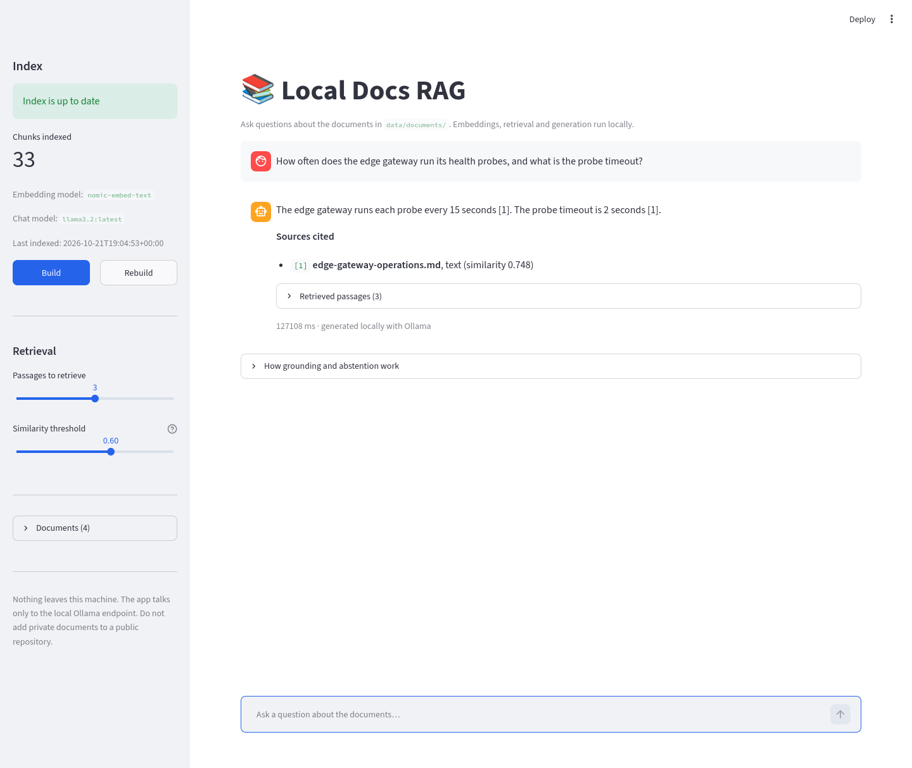

# local-docs-rag-assistant

> Ask questions about your own PDFs and Markdown manuals and get answers with page-level citations — or an honest "I don't have enough information". Everything runs on your machine.

**Status:** ✅ MVP implemented. Retrieval, grounded generation, citation enforcement, abstention, Streamlit UI, automated tests and a 24-question evaluation are included.



*A local answer with an inline citation and its source. The screenshot was taken
from the running app on CPU; the latency shown is real, not simulated.*

## Why this project exists

Operational knowledge usually lives in PDF manuals, and uploading those documents to a cloud service is not always allowed. This project runs the full retrieval-augmented generation (RAG) pipeline locally with [Ollama](https://ollama.com): documents are parsed, chunked, embedded and stored in SQLite; retrieval uses cosine similarity; only the retrieved passages are sent to the local chat model. Every substantive answer must cite a file (and page, when available), and the assistant abstains when the retrieved evidence is insufficient.

The interesting part is not the chatbot — it is the evaluation: 24 questions with known answers, a fixed validation/test split, a similarity threshold tuned only on validation, and explicit measurement of retrieval, citation support and abstention.

## What it demonstrates

- End-to-end RAG over local documents, with no external API.
- Local embeddings and chat models through Ollama, selected by environment variables.
- Persistent indexing with SQLite + NumPy and idempotent re-indexing.
- Evidence-grounded answering with citation validation and abstention.
- A reproducible 24-question evaluation with a held-out test split.
- Clear failure behavior: missing models, no evidence and uncited answers are handled explicitly.

## MVP scope

- Streamlit app that indexes PDF, Markdown and TXT files from `data/documents/`.
- Local embeddings from Ollama, stored with text, filename and page.
- Cosine-similarity search over chunks; top-3 passages per question.
- Configurable local chat model; answers restricted to retrieved context.
- Citations showing filename and page (when the source is a PDF).
- Buttons to build the index, rebuild it from scratch and inspect retrieved passages.
- Evaluation over 24 JSONL questions: 18 answerable, 6 unanswerable.

**Out of scope:** login, multi-user support, remote history, cloud deployment, web scraping, Office documents, answers without sources, model training or fine-tuning.

## Architecture

```text
data/documents/  →  loader  →  chunker  →  embedder  →  SQLite index
                                                             │
question  ──────────────────────────────→  retriever (top-3) ┘
                                                 │
                                                 ▼
                                             answerer  →  answer + citations
                                                 │
                                       Streamlit UI / evaluate.py
```

| Module | Responsibility |
|--------|----------------|
| `loader.py` | Loads `.pdf`, `.md`, `.txt`; normalizes text; keeps PDF page numbers. |
| `chunker.py` | Paragraph-first packing, max 800 chars, 120-char target overlap. |
| `embedder.py` | Batched calls to Ollama's `/api/embed`, with actionable errors. |
| `index.py` | SQLite persistence, corpus fingerprint, idempotent rebuild, cosine search. |
| `retriever.py` | Embeds the question, retrieves top-k and applies the threshold. |
| `answerer.py` | Grounded prompt, citation parsing, citation enforcement and abstention. |
| `pipeline.py` | Wires the components for the UI and the evaluation script. |
| `app.py` | Streamlit interface with index controls, answers and retrieved passages. |

### Grounding and abstention

1. The question is embedded with the same model used for the corpus.
2. The three nearest chunks above the similarity threshold are retrieved.
3. If no chunk passes the threshold, the app abstains without calling the chat model.
4. The prompt allows only the numbered chunks as evidence and requires a citation
   marker (`[1]`, `[2]`, …) for every factual sentence.
5. If the model returns an answer without a valid citation, the answer is discarded
   and replaced by the abstention message. This prevents plausible but unsourced prose
   from being presented as documented fact.

The threshold is **0.60** for the sample corpus and `nomic-embed-text`. It was chosen
on the validation split only (`eval/evaluate.py --tune-threshold`) and is stored in
`.env`. Changing the documents or embedding model requires retuning it.

## Sample corpus

The four documents in `data/documents/` are **original, fictional technical
documents** written for this demo and licensed under **CC BY 4.0**:

| File | Format | Pages |
|------|--------|-------|
| `edge-gateway-operations.md` | Markdown | — |
| `incident-response-runbook.md` | Markdown | — |
| `python-service-checklist.md` | Markdown | — |
| `open-systems-handbook.pdf` | PDF (generated) | 6 |

They contain no real company data, customer information, personal data or
credentials. The PDF is generated reproducibly by `tools/build_sample_pdf.py`.
See [`data/README.md`](./data/README.md) for the licensing details.

The sample corpus produces **33 chunks from 4 source files**. The `documents` count
in the UI refers to source files, not to PDF pages.

## Repository layout

```text
local-docs-rag-assistant/
├── app.py                      # Streamlit entry point
├── src/rag/
│   ├── config.py               # Environment-based settings
│   ├── loader.py               # PDF/MD/TXT ingestion, page-aware
│   ├── chunker.py              # Paragraph-first chunking (800/120)
│   ├── embedder.py             # Ollama embeddings client
│   ├── index.py                # SQLite + NumPy cosine search
│   ├── retriever.py            # top-k retrieval + threshold
│   ├── answerer.py             # Grounded prompt + citations + abstention
│   └── pipeline.py             # Shared application pipeline
├── eval/
│   ├── questions.jsonl         # 24 labeled questions (12 validation / 12 test)
│   ├── evaluate.py             # Retrieval, answer and threshold evaluation
│   └── README.md               # Evaluation method and schema
├── data/
│   ├── documents/              # Sample corpus (CC BY 4.0)
│   ├── README.md               # Corpus provenance and license
│   └── index.sqlite3           # Generated index (gitignored)
├── tools/build_sample_pdf.py   # Reproducible sample PDF
├── tests/                      # 34 unit and integration tests
├── docs/
│   ├── screenshot.png          # Real app screenshot
│   └── evaluation.md           # Full results and failure analysis
├── reports/                    # Generated evaluation reports (gitignored)
├── .streamlit/config.toml      # No telemetry; local-only UI defaults
├── .env.example
├── requirements.txt
└── README.md
```

## Stack

| Layer | Choice |
|-------|--------|
| Language | Python 3.11+ |
| LLM / embeddings | Ollama (local HTTP API) |
| Storage | SQLite + NumPy |
| UI | Streamlit |
| PDF parsing | PyMuPDF |
| Evaluation | pandas |
| Tests | pytest |

**Minimum resources:** Python 3.11+, 8 GB RAM and enough disk for the Ollama
models (about 2.5 GB). A GPU is optional. The reference run used 8 CPU cores with
no GPU. Direct Python dependencies are pinned in `requirements.txt` to the
versions used for the reference run.

## Quickstart

```bash
cd local-docs-rag-assistant
python3.11 -m venv .venv
source .venv/bin/activate
pip install -r requirements.txt

cp .env.example .env

# In a separate terminal, if Ollama is not already running as a service:
ollama serve

# Pull the default local models (any compatible models can be used instead):
ollama pull nomic-embed-text
ollama pull llama3.2:latest

streamlit run app.py
```

Open the URL printed by Streamlit, click **Build** in the sidebar, then ask a
question. The first index build embeds 33 chunks and takes under a minute on CPU.

To use different models, edit `OLLAMA_CHAT_MODEL` / `OLLAMA_EMBED_MODEL` in `.env`
and rebuild the index (the embedding model is part of the corpus fingerprint).
Models are never hardcoded in the application logic.

### CLI evaluation

```bash
# Fast retrieval-only check (no chat model)
python eval/evaluate.py --rebuild --retrieval-only

# Tune the threshold on validation only
python eval/evaluate.py --tune-threshold

# Final retrieval + generation on validation and test
python eval/evaluate.py
```

Reports are written to `reports/` and are gitignored. See
[`eval/README.md`](./eval/README.md) for the question schema and metric definitions.

## Evaluation results

Run on 2026-10-21 with `nomic-embed-text`, `llama3.2:latest` (3B), top-3 and the
validation-selected threshold `0.60`, on an 8-core CPU with no GPU. The full
report and failure analysis are in [`docs/evaluation.md`](./docs/evaluation.md).

| Metric | Validation | Test | Target |
|--------|------------|------|--------|
| Expected source is top-1 | 9/9 | 9/9 | — |
| Expected source is in top-3 | 9/9 | 9/9 | ≥ 7/9 |
| Citation points to the expected source | 9/9 | 9/9 | — |
| Answer supported by cited passage (manual) | 9/9 | 8/9 | ≥ 7/9 |
| Correct abstention on unanswerable questions | 3/3 | 3/3 | ≥ 2/3 |
| Median latency, answerable questions | 110.9 s | 82.0 s | — |
| Median latency, all questions | 73.9 s | 80.3 s | — |

The automated lexical support proxy agreed with the manual labels (9/9 on
validation, 8/9 on test), but the manual review is the authoritative metric.

**One test failure is reported, not hidden.** `t07` answered the retry question
correctly but cited the adjacent chunk, which does not contain "3 attempts" or
"jitter". It was marked unsupported. This is a citation-grounding failure: the
app validates that a citation exists and maps to a retrieved chunk, but not that
the chunk supports every sentence. Sentence-level citation verification is the
next improvement; the manual review column is what catches this class of error
today.

## Reproduce the tests

```bash
python -m pytest
```

The suite covers loading (including PDF page numbers), chunk sizes and overlap,
index idempotency, cosine search, threshold filtering, citation parsing,
citation enforcement, abstention, the fixed evaluation split, local-only
configuration and an offline end-to-end pipeline test with fake embeddings.

## Design decisions and trade-offs

- **SQLite + NumPy instead of a vector database.** The corpus is small; this keeps
  the demo to one file and makes the retrieval math inspectable. It would not scale
  to millions of chunks.
- **Paragraph-first chunking with overlap.** Preserves readable context and avoids
  cutting sentences whenever possible. Chunks target 800 characters and a
  120-character overlap; the overlap may grow to keep a sentence whole. These are
  deliberate defaults, not a tuned optimum.
- **Fingerprint-based re-indexing.** The index stores a hash of the corpus, chunking
  parameters and embedding model. Rebuilding unchanged content is a no-op, so the
  app cannot silently duplicate documents.
- **Citation enforcement.** A fluent answer without a valid citation is treated as
  a failure, not as a success. This trades some answer coverage for auditability.
- **Threshold tuned on validation.** The test split is never used to select the
  threshold, avoiding optimistic reporting.
- **Small local model by default.** `llama3.2` (3B) runs on CPU with no GPU
  requirement, but is slower and weaker than larger models. The model is one
  environment variable away from being replaced.

## Project build plan

- [x] 1. Select a corpus and write 24 verifiable questions.
- [x] 2. Implement page-aware loading and paragraph-first chunking.
- [x] 3. Create embeddings and a persistent, idempotent index.
- [x] 4. Implement top-k search and inspect retrieved chunks.
- [x] 5. Add grounded answers with citations and abstention.
- [x] 6. Build the Streamlit interface.
- [x] 7. Run validation and test evaluation; store results locally.
- [x] 8. Capture an app screenshot and document the evaluation.

## Acceptance criteria

- [x] The app runs locally following only this README.
- [x] Every substantive answer shows at least one existing citation.
- [x] A question outside the corpus produces abstention.
- [x] Re-indexing without changes does not duplicate documents.
- [x] Evaluation reports retrieval, citation support, abstention and latency.
- [x] No document or question is sent to an external API.

## Known limitations

- Manual evaluation on 24 questions is a small sample. Results are reported as rates
  with their method, not as statistical "accuracy".- The automated support metric is a lexical proxy; the manual review described in
  `eval/README.md` remains the authoritative check.
- Citations are validated for existence and source, not sentence by sentence.
  The evaluation includes one case (`t07`) where the answer is correct but the
  cited chunk is the adjacent one. Sentence-level citation verification is future
  work.
- Retrieval quality depends on the embedding model and on PDF text extraction;
  scanned PDFs without a text layer are not supported.
- Brute-force cosine similarity is appropriate for a small corpus, not for large
  collections.
- The default chat model can be verbose or omit a citation; uncited answers are
  deliberately converted into abstentions.
- The reference environment is an 8-core CPU with no GPU. Generation takes
  roughly 70–140 seconds per answer; embeddings are fast. A GPU or a larger model
  improves latency but is not required for the demo.
- The default `llama3.2` 3B model can still make mistakes under distracting
  retrievals. The evaluation reports those failures instead of hiding them.
- The prompt is deliberately conservative: a named entity that does not appear in
  any source pushes the model toward abstention. This favors safety over coverage.
- The local-only guard accepts loopback hosts only (`localhost`, `127.0.0.1`, `::1`).
  A remote Ollama endpoint is rejected on purpose.
- No conversation memory, authentication or multi-user isolation.

## Data and privacy

Only documents with a verifiable license are used. The sample corpus is original,
fictional and CC BY 4.0; it contains no personal or work data. The pipeline talks
exclusively to the local Ollama endpoint — there is no cloud fallback and no
telemetry. The SQLite index and evaluation reports are generated locally and are
excluded from version control.

## License

MIT — see [`LICENSE`](./LICENSE). The sample corpus in `data/documents/` is
CC BY 4.0, as described in [`data/README.md`](./data/README.md).
